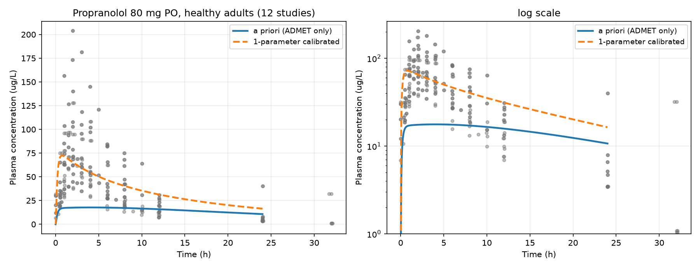
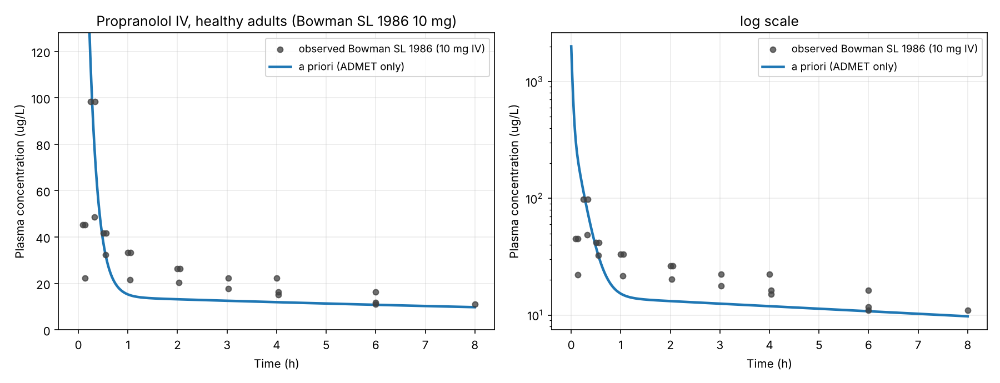

# PK-ADMET-Predictor

**구조 기반 ADMET 예측값만으로 사람의 혈중 농도를 예측할 수 있는가.**

TDC ADMET 벤치마크 세 과제로 예측 모델을 만들고, 그 예측값을 축소 PBPK에
넣어 출판된 프로프라놀롤 human PK와 비교했다. 결론부터 말하면 **a priori로는
Cmax를 하나도 맞히지 못했고**, 왜 못 맞혔는지를 IV 데이터로 가려냈다.

## 핵심 결과

프로프라놀롤 경구 80 mg, 건강 성인, 12개 연구 288점과 비교.

| | Cmax 기하평균 배수오차 | 2배 안쪽 | AUC 배수오차 | 2배 안쪽 |
| --- | --- | --- | --- | --- |
| a priori (ADMET 예측값만) | 4.97 | **0%** | 2.26 | 42% |
| 파라미터 1개 보정 | 1.48 | 82% | 1.51 | 91% |

세 가지가 이 결과에서 나왔다.

**1. 틀린 곳은 흡수다.** 관측 데이터에 IV가 있어 흡수와 소실을 분리할 수
있었다. IV는 a priori 그대로 배수오차 1.21로 들어온다. 소실 쪽(fu, CLint)은
대체로 맞고 틀린 것은 흡수 쪽이다. 보정할 파라미터로 Caco-2 → Peff 상관식의
절편을 고른 것은 이 진단의 결과이고, 그 절편 하나만 연구 1개에 맞춰
나머지 11개로 확인했다.

**2. F가 맞아 보이는 것은 오차 상쇄였다.** `F = Fa × (1 − E_h)`에서 Fa를
과소평가하고(0.26) E_h도 과소평가해(0.27, 문헌 0.6~0.75) 방향이 반대라
서로 지워졌다. 프로프라놀롤은 거의 완전히 흡수되지만 초회통과로 대부분
잃는 약물인데, 모델은 "조금 흡수되고 조금 잃는" 쪽으로 틀렸다. 숫자는
맞는데 기전이 틀린 경우다.

**3. 특징 추출이 원리적으로 볼 수 없는 것이 있다.** 누출 검사에서
프로프라놀롤이 `PPBR_AZ` train에 4건(R체·S체) 있었다. 더 중요한 것은
Morgan fingerprint가 `includeChirality=False`이고 descriptor도 전부
비카이랄이라 **모델 입장에서 R체·S체·라세미체가 같은 입력**이라는 점이다.
프로프라놀롤은 실제로 거울상 간 단백결합·대사가 다른 약물이다. PPBR만
해당 분자를 빼고 재학습해 예측했다.

### 경구 — 맞히지 못한 쪽



점은 관측 288개, 실선이 a priori, 점선이 절편 하나를 보정한 곡선이다.
a priori 곡선(실선)은 봉우리를 만들지 못하고 관측 구름 아래를 평평하게
지나간다. Cmax를 하나도 맞히지 못했다는 표의 0%가 이 모양이다.

### 정맥 — 맞힌 쪽



같은 파라미터인데 IV에서는 a priori 곡선이 관측을 그대로 따라간다
(AUC 배수오차 1.21). 보정 곡선을 겹쳐 그리지 않은 것은, 보정한 것이 ka와
Fa뿐이라 IV에서는 두 곡선이 완전히 포개지기 때문이다. 흡수 가정이 전혀
들어가지 않은 이 그림이 맞는다는 것은 소실(fu, CLint)이 대체로 옳다는
뜻이고, 그래서 경구에서 어긋난 책임은 흡수 쪽에 있다. 위 1번의 근거가
두 그림의 이 대비다.

자세한 기록: [`docs/04_week3_pbpk.md`](docs/04_week3_pbpk.md)

## 왜 이 세 과제인가

TDC ADMET Benchmark Group의 22개 과제 중, 내가 벤치에서 직접 측정해 본
물성 세 가지를 골랐다. 데이터가 어떻게 만들어지는지 아는 상태에서 예측
모델을 만들고, 그 예측이 PK 예측에 쓸 만한지까지 판단하는 것이 목표였다.

| 과제 | 물성 | 공식 지표 | 내 실험 경험 |
| --- | --- | --- | --- |
| `Clearance_Microsome_AZ` | 간 마이크로솜 고유 청소율 | Spearman | 대사안정성 LC-MS/MS(QQQ) 측정 |
| `PPBR_AZ` | 혈장단백결합률 | MAE | 랫드 혈장단백결합·입체선택적 대사 |
| `Caco2_Wang` | Caco-2 투과도 | MAE | Caco-2 투과도 평가·모델링 |

세 과제 모두 TDC가 scaffold split을 쓴다. train과 test에 구조적으로 다른
분자가 들어가므로 무작위 분할보다 어렵고, 처음 보는 골격을 예측해야 하는
실제 상황에 가깝다.

## 예측 모델

### 베이스라인 (트리 모델)

세 과제 모두 RandomForest에 descriptor+fingerprint를 넣은 것이 가장 좋았다.

| 과제 | 지표 | 최고 (rf desc+fp) | 2위 |
| --- | --- | --- | --- |
| `Caco2_Wang` | MAE ↓ | **0.279 ± 0.003** | lgbm desc+fp 0.281 ± 0.002 |
| `PPBR_AZ` | MAE ↓ | **8.657 ± 0.020** | lgbm desc+fp 8.747 ± 0.051 |
| `Clearance_Microsome_AZ` | Spearman ↑ | **0.506 ± 0.002** | lgbm fp 0.492 ± 0.014 |

fingerprint만 쓴 쪽이 descriptor만 쓴 쪽보다 좋은 과제는 Clearance
뿐이다(0.445 vs 0.425). 투과도·단백결합은 분자 전체의 물리화학적 성질이
지배하는데 대사 청소율은 특정 대사 취약부위가 결정하기 때문으로 읽는다.
구조를 직접 보는 GNN이 Clearance에서 가장 많이 오를 것이라는 가설을
여기서 세웠다.

### 신경망

가설대로 됐다. 네 모델 모두 **입력이 과제의 물리에 맞을 때만 이긴다.**

| 과제 | 지표 | rf desc+fp | MLP | GIN | GIN+desc |
| --- | --- | --- | --- | --- | --- |
| `Caco2_Wang` | MAE ↓ | **0.279 ± 0.003** | 0.288 ± 0.012 | 0.434 ± 0.033 | 0.343 ± 0.026 |
| `PPBR_AZ` | MAE ↓ | 8.657 ± 0.020 | 8.283 ± 0.245 | 8.240 ± 0.527 | **7.982 ± 0.350** |
| `Clearance_Microsome_AZ` | Spearman ↑ | 0.506 ± 0.002 | 0.508 ± 0.025 | 0.524 ± 0.040 | **0.562 ± 0.027** |

descriptor를 넣으면 세 과제 모두 GIN이 좋아진다(0.434→0.343,
8.240→7.982, 0.524→0.562). 예외가 없고 **개선 폭이 가장 큰 것이
Caco2**다. 그 과제가 물리화학적 성질을 가장 많이 필요로 하기 때문이고,
베이스라인에서 fingerprint가 descriptor를 이긴 과제가 Clearance 뿐이었던
것과 같은 이야기의 뒷면이다.

descriptor는 분자 하나당 한 벡터라서 원자 단위가 아니라 readout 뒤에
붙인다. 열마다 스케일이 전혀 달라(MolWt 수백, qed 0~1, BertzCT 수천)
정규화가 필요하고, 통계는 train에서만 구해 세 split에 적용한다. 트리
모델에는 없던 문제다.

**seed 고정만으로는 재현되지 않았다.** `index_add_`의 병렬 덧셈 순서
때문에 같은 seed로도 GIN 결과가 달라졌다(부동소수점 덧셈은 결합법칙이
성립하지 않는다). 결정적 커널을 강제해 고쳤고, 전체 격자를 다시 돌린 뒤
두 번 실행해 평균·표준편차·멈춘 epoch이 모두 같은 것을 확인했다. 위 표는
그 결정적 실행의 숫자다. 추적 과정은
[`docs/03_week2_notes.md`](docs/03_week2_notes.md).

하이퍼파라미터는 test를 보고 고르지 않았다. 데이터 크기만 보고 미리
정했고(batch 64, AdamW lr 1e-3, Huber loss, patience 40), epoch 선택은
전부 valid로 했다. `results/models.csv`에 seed별 valid 점수와 멈춘 epoch을
남겨 근거를 볼 수 있게 했다.

## PBPK 모델

```
경구 ──ka──▶ 장 내용물 ──▶ 간 ──Qh──▶ 중앙(혈액) ◀──Qp──▶ 말초
                           │              ▲
                      CLint·fu            │
                           ▼          IV 투여
                         소실
```

흡수된 약물이 중앙이 아니라 간으로 먼저 들어간다(문맥순환). 초회통과가
구조에서 자연히 나오고, 프로프라놀롤은 초회통과가 커서 이 구조의 시험대가
된다. 전신 PBPK로 가지 않은 이유는 그만큼의 파라미터를 세 개의 예측값으로
뒷받침할 수 없기 때문이다. 구획을 늘리면 모델이 좋아지는 게 아니라 임의로
정한 숫자가 늘어난다.

| ADMET 과제 | 파라미터 | 변환 | 가정의 크기 |
| --- | --- | --- | --- |
| `PPBR_AZ` | fu | `fu = 1 − PPB/100` | 없음 (정의) |
| `Clearance_Microsome_AZ` | CLint | MPPGL 45 mg/g × 간 1800 g | 작음 (교과서 IVIVE) |
| `Caco2_Wang` | ka, Fa | log-log 상관식 → `ka = Peff·2/R` | **큼 ← 약점** |

분포 용적은 세 과제가 말해 주지 않는다. 조직 분배계수는 RDKit이 구조에서
계산한 `MolLogP`와 fu로 조직 조성법을 써서 구한다. TDC 모델의 예측이
아니다.

## 한계

솔직하게 적어 둔다.

- **약물 하나, 용량 하나다.** 12개 연구가 전부 프로프라놀롤 경구 80 mg
  이다. 절편을 1개 연구에 맞추고 11개로 확인한 것은 **같은 시나리오의
  연구 간 변동 안에서 재현된다**는 뜻이고, 다른 약물이나 다른 용량으로의
  외적 타당성은 검증하지 않았다. a priori가 Cmax를 못 맞혔다는 것도 초회
  통과가 큰 약물 하나에서 Caco-2 → Peff 상관식이 약한 고리였다는 좁은
  주장까지만 유효하다.
- **Tmax는 못 맞춘다.** 관측 1.5~3.0 h, a priori 4.0, 보정 후 0.75.
  Cmax를 맞추면 Tmax가 어긋난다. 흡수를 1차 속도상수 하나로만 써서 봉우리
  모양을 만들 자유도가 없는 구조적 한계다. transit compartment로 쪼개면
  해결되는 알려진 문제다.
- **IV 검증은 부분 AUC다.** 8시간까지라 초기 분포를 주로 본다. 전체
  청소율을 완전히 검증한 것은 아니다.
- **Caco-2 → Peff 상관식의 상수(기울기 0.6, 절편 −1.9)는 검증이 필요한
  가정이다.** 보정 결과는 절편이 −1.53 쪽이라고 말한다. 원 상관식의 출처와
  적용 범위를 확인해야 그 차이를 해석할 수 있다.
- **신경망의 표준편차가 트리 모델보다 한 자릿수 크다**(0.026~0.527 대
  0.002~0.020). seed 5개의 표준편차 대비 2배는 일관된 방향이라고는 말할 수
  있어도 엄밀한 유의성 주장은 아니다.
- **DDP는 미검증이다.** 코드는 `scripts/train_ddp.py`에 있지만 이 PC는
  GPU가 한 장이라 `world_size=1` 이상을 확인할 수 없었다.
- **LightGBM 버전이 플랫폼마다 갈린 적이 있다.** Windows(4.6.0)와
  Linux(4.7.0)에서 Clearance의 lgbm 두 조합이 표준편차 안쪽에서 달랐다.
  RandomForest 9조합은 세 환경에서 완전히 일치한다. 지금은
  `environment.yml`과 `requirements.txt` 양쪽에 `lightgbm` 4.7.0,
  `scikit-learn` 1.9.1로 고정해 두었다. 위 표의 숫자는 그 버전의 것이다.

## 다음 수

- 흡수를 transit compartment로 바꿔 Tmax 맞추기
- fingerprint에 카이랄 정보 포함 — 입체선택적 물성을 볼 수 있게
- 프로프라놀롤로 맞춘 절편을 **다른 약물**에 그대로 적용해 외적 타당성 보기
- 특수군(간경변·영아·임신) 외삽. 데이터는 이미 있고 생리 파라미터만 바꾸면
  된다

## 재현

환경 구성은 [`docs/00_setup_wsl2_cuda.md`](docs/00_setup_wsl2_cuda.md).
WSL2 Ubuntu-24.04(권장)와 Windows 네이티브 두 환경에서 모두 돌렸고 둘 다
`cuda available : True`다. 막혔던 지점과 해결은
[`docs/02_week1_issues.md`](docs/02_week1_issues.md)에 남겼다(BIOS 가상화,
Windows의 `tiledbsoma` 휠 부재, `setuptools<81`, MKL BLAS에서
`np.corrcoef`가 프로세스를 죽인 것 등).

```bash
conda env create -f environment.yml && conda activate pk-admet
# WSL에서는 PyTDC가 CUDA torch를 끌고 온다. Windows라면 따로:
#   pip install torch --index-url https://download.pytorch.org/whl/cu124

python scripts/check_env.py     # 패키지·CUDA 확인
python scripts/smoke_test.py    # 네트워크 없이 RDKit·모델 확인
python scripts/run_baseline.py  # 3과제 x 2모델 x 3특징 x 5seed
python scripts/run_models.py    # MLP, GIN, GIN+desc
python scripts/run_pbpk.py      # ADMET 예측 -> PBPK -> 관측 PK 비교
```

## 저장소 구조

```
src/config.py          대상 과제, 지표, seed 정의
src/data.py            TDC 로드와 train/valid/test 분할
src/features.py        RDKit descriptor(27개) + Morgan fingerprint(2048비트)
src/baseline.py        RandomForest / LightGBM, TDC 공식 평가 호출
src/graph.py           SMILES -> 원자/결합 그래프 (GNN 입력)
src/torch_data.py      Dataset 2종 + collate_fn 직접 작성, 타깃 정규화
src/models.py          MLP, GIN (torch_geometric 없이 직접 구현)
src/train.py           학습 루프, valid 기반 early stopping
src/utils.py           난수 고정, 결정적 실행, 결과 저장
pbpk/model.py          간·장 축소 PBPK (ODE 4개), ADMET -> 파라미터 변환
pbpk/predict_admet.py  대상 분자 물성 예측 (누출 분자는 제외 재학습)
pbpk/observed.py       출판된 human PK 엑셀 파싱
scripts/               check_env, smoke_test, run_baseline, run_models,
                       train_ddp, run_pbpk
notebooks/             01_rdkit_intro — RDKit 기초 + 데이터 탐색
docs/                  환경 구성, 막혔던 것들, 주차별 기록
data/ results/         TDC 캐시와 결과 (저장소에는 요약만 올린다)
```

관측 데이터 파싱에 함정이 둘 있었다. 같은 곡선이 논문 단위 블록과 정리된
단위 블록에 두 번 들어 있어 그대로 읽으면 연구가 두 배로 세어지고,
'Time (h)'라고 적혀 있는데 분이 든 시트가 있다(tmax 717.8 "시간"). 헤더를
믿지 않고 값이 100시간을 넘으면 분으로 간주한다. 고치고 나니 12개 연구
Tmax가 전부 1.5~3.0 h로 들어왔고 이는 문헌값과 일치한다.

## 규칙

- **test set으로 모델을 고르지 않는다.** TDC가 준 train/valid만 쓰고,
  평가는 `group.evaluate()` / `group.evaluate_many()`로만 한다.
- seed 5개의 평균±표준편차로 보고한다. 한 번 잘 나온 숫자는 쓰지 않는다.
- 미공개 실험 데이터는 넣지 않는다. 공개 데이터와 이미 발표된 논문만 쓴다.

## 출처

- [TDC ADMET Benchmark Group](https://tdcommons.ai/benchmark/admet_group/overview/)
