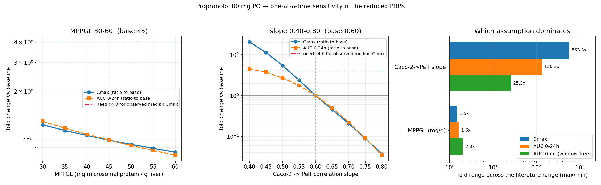
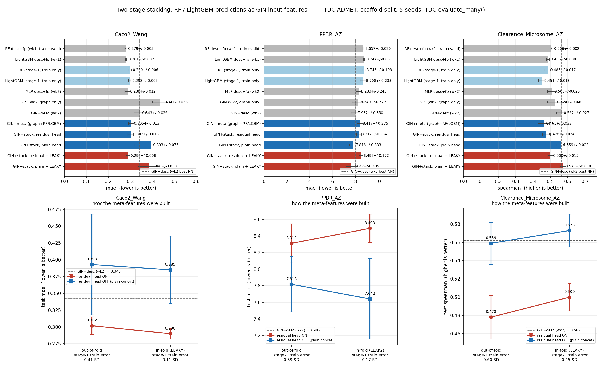

# PK-ADMET-Predictor

**화학 구조 기반의 ADMET 예측값만으로 사람의 혈중 약물 농도-시간 곡선(PK profile)을 예측할 수 있는지 검증하고, 예측 오차가 발생하는 단계를 분리해 진단한 프로젝트임.**

약물의 SMILES 구조로부터 세 가지 ADMET 물성(`Caco2_Wang`, `PPBR_AZ`, `Clearance_Microsome_AZ`)을 머신러닝으로 예측한 뒤, 이를 4-compartment **minimal PBPK (mPBPK)** 모델에 입력해 Propranolol의 실제 human clinical PK 데이터와 비교했다. 이어 5주차에서는 tree-based model(1단)의 예측을 graph neural network(2단)에 결합하는 2-stage OOF stacking 실험을 수행해 구조적 한계와 설계 조건을 검증했다.

---

## 전체 분석 흐름 (Pipeline)

```text
[1. Molecular Input]     [2. ADMET Prediction]        [3. mPBPK Simulation]          [4. Clinical PK & Stacking]
  SMILES string    ──▶    Caco-2 permeability   ──▶   Gut → Liver → Central ↔ Peri   ──▶  PO (80 mg) · IV (5 curves)
  Descriptors / Graph     PPBR / Hepatic CLint        4-compartment ODE                   Sensitivity · Chirality · 2-stage Stacking
```

1. **Featurization (`src/features.py`, `src/graph.py`, `src/stereo.py`)**: SMILES 문자열을 27개 physicochemical **descriptor**, 2048-bit **Morgan fingerprint**, 또는 atom-bond **molecular graph**로 변환한다.
2. **ADMET Model Training (`src/baseline.py`, `src/models.py`, `src/train.py`)**: TDC benchmark 데이터셋으로 tree-based model과 neural network를 동일한 split 기준으로 비교한다.
3. **mPBPK Simulation (`pbpk/predict_admet.py`, `pbpk/model.py`)**: 예측된 ADMET 값을 70 kg 성인 기준 physiological constants와 결합해 시간별 plasma concentration을 계산한다.
4. **Clinical Validation & Verification (`pbpk/observed.py`, `scripts/run_pbpk.py`, `scripts/run_chirality.py`, `scripts/run_sensitivity.py`, `scripts/run_sanity.py`)**: 문헌에서 수집한 healthy adult clinical PK 데이터와 비교하고, chiral fingerprint 재실험 및 parameter sensitivity analysis로 결론의 근거를 검증한다.
5. **2-Stage OOF Stacking (`src/stacking.py`, `src/stack_predict.py`, `scripts/run_stack.py`)**: `desc+fp` 기반 1단 tree model의 5-fold OOF 예측값을 2단 `GIN+desc`에 meta feature로 결합해 성능 개선 여부와 정보 중복 구조를 검증한다.

---

## 핵심 결과 요약

Propranolol **single-dose PO 80 mg** 투여 시(healthy adults, total concentration 7 curves from 6 studies, 73 data points) 실제 관측값과 시뮬레이션 결과를 비교했다.

* **a priori prediction**: clinical PK 데이터를 전혀 보지 않고 ADMET 예측값만으로 계산한 결과임.
* **1-parameter calibration**: `Caco-2 → Peff` 경험식의 intercept(`-1.9`) 하나만 1개 curve에 맞춰 보정하고, 나머지 6개 holdout curves로 검증한 결과임.
* **GMFE (Geometric Mean Fold Error)**: 예측값과 관측값의 비율 차이를 나타내는 지표로, `1.0`에 가까울수록 정확하며 PK에서는 보통 2-fold 이내(0.5–2.0)를 허용 범위로 본다.

| Mode (PO 80 mg single-dose) | Cmax GMFE | Within 2-fold (Cmax) | AUC GMFE | Within 2-fold (AUC) |
| --- | --- | --- | --- | --- |
| **a priori** (ADMET 예측값만 사용) | 4.51 | 0.0% | 1.97 | 57% |
| **1-parameter calibrated** (6 holdout curves) | 1.51 | 83% | 1.41 | 100% |

### 주요 진단 결과

1. **Absorption과 Elimination의 분리 진단 (IV Cross-Check)**
   IV 투여(5 curves)는 gut absorption을 거치지 않고 central compartment로 직접 들어간다. IV 데이터에서 부분 AUC는 **1.22-fold**로 맞지만, **terminal half-life는 약 3.8배 길고**(관측 3.3–5.3 h vs. 모델 13.9 h, 곡선별 2.6–4.2배), **clearance는 2.5배 낮게**(관측 중앙값 61 L/h vs. 모델 24.6 L/h) 예측되었다. 즉 틀린 것은 absorption만이 아니며, absorption intercept만 보정한 모델은 single-dose 80 mg에서는 맞지만 steady-state나 다회 투여처럼 약물이 축적되는 조건에서는 AUC를 약 2배 과대예측한다.
2. **겉보기 Bioavailability (`F`) 일치 이면의 Error Cancellation**
   Oral bioavailability는 `F = Fa × (1 − E_h)`로 계산된다. a priori 예측에서 `F = 0.185`로 문헌값(`~0.26`)과 비슷해 보였으나, 실제로는 `Fa`와 hepatic extraction ratio `E_h`를 모두 과소평가해 두 오차가 반대 방향으로 상쇄된 결과였음.
3. **Achiral Features의 구조적 한계와 Data Leakage 방지**
   Propranolol은 R/S **enantiomer**에 따라 실제 protein binding과 metabolism 속도가 다르다. 하지만 기본 입력(`Morgan fingerprint` with `includeChirality=False`, 27 achiral descriptors)은 **chirality**를 구분하지 못해 R체·S체·racemate를 동일한 입력으로 인식한다. 또한 `PPBR_AZ` train set에 Propranolol 4건(R·S체 각 2건)이 포함되어 있음을 확인해, mPBPK 입력 예측 시 해당 분자를 제외하고 재학습했다.

### PO vs. IV 비교 그래프


* **왼쪽 두 패널 (PO 80 mg single-dose)**: 보정 곡선이 관측 점 위를 지나가지만, log scale에서는 말단 꼬리(tail)가 관측 점들 위로 떠 있음.
* **오른쪽 패널 (Dose-normalized IV, 5 curves)**: Absorption 가정이 들어가지 않는 IV 곡선으로, 4시간 이후부터 관측 점이 모델 선 아래로 내려가고 14시간에는 약 5배 벌어진다. 이는 보정이 교정한 대상이 absorption뿐임을 뒷받침한다.

자세한 시뮬레이션 기록은 [docs/04_week3_pbpk.md](docs/04_week3_pbpk.md)에서 확인할 수 있다.

---

## 1단계: ADMET 예측 모델

[TDC ADMET Benchmark Group](https://tdcommons.ai/benchmark/admet_group/overview/)에서 mPBPK 입력에 직접 필요한 3가지 task를 선정했다. 모든 데이터는 구조적으로 다른 분자를 예측하는 실제 상황에 가깝도록 **scaffold split**을 적용해 평가했다.

| Task | Property (Unit) | Official Metric | Role in mPBPK |
| --- | --- | --- | --- |
| `Caco2_Wang` | Intestinal permeability (`log Papp`, cm/s) | MAE ↓ | `Peff`, `ka`, `Fa` 추정 |
| `PPBR_AZ` | Plasma protein binding rate (`%`) | MAE ↓ | Plasma unbound fraction (`fu`) 계산 |
| `Clearance_Microsome_AZ` | Hepatic microsome intrinsic clearance (`uL/min/mg`) | Spearman ↑ | Hepatic `CLint` 및 `E_h` 계산 |

### 모델 비교 결과 (5 seeds, mean ± std)

Tree-based baseline (`RandomForest`, `LightGBM`)과 neural network (`MLP`, `GIN`, `GIN+desc`)를 동일한 split 기준으로 비교했다.

| Task | Metric | RF (`desc+fp`) | LightGBM (`desc+fp`) | MLP | GIN (graph only) | GIN+desc (graph+desc) |
| --- | --- | --- | --- | --- | --- | --- |
| `Caco2_Wang` | MAE ↓ | **0.279 ± 0.003** | 0.281 ± 0.002 | 0.288 ± 0.012 | 0.434 ± 0.033 | 0.343 ± 0.026 |
| `PPBR_AZ` | MAE ↓ | 8.657 ± 0.020 | 8.747 ± 0.051 | 8.283 ± 0.245 | 8.240 ± 0.527 | **7.982 ± 0.350** |
| `Clearance_Microsome_AZ` | Spearman ↑ | 0.506 ± 0.002 | 0.486 ± 0.008 | 0.508 ± 0.025 | 0.524 ± 0.040 | **0.562 ± 0.027** |

* **Task 특성에 따른 모델 적합성**: 분자 전체의 physicochemical properties가 지배적인 `Caco2_Wang`에서는 descriptor를 활용하는 tree model이 가장 뛰어났다. 반면 특정 metabolic soft spot이 중요한 `Clearance_Microsome_AZ`에서는 원자 연결 구조를 직접 보는 `GIN+desc`가 가장 높은 성능을 보였다.
* **Descriptor 결합 효과**: Graph만 입력받는 `GIN`에 27개 descriptor를 결합(`GIN+desc`)하면 세 task 모두 평균값이 향상되었다(단 `PPBR_AZ`는 seed 간 std가 커 구간이 겹친다).
* **엄격한 평가 및 Reproducibility**: **test set**은 최종 평가에만 사용하며, **feature/target normalization** 통계량과 **early stopping** 기준은 `train`/`valid`에서만 계산한다. 또한 PyTorch GPU 연산(`index_add_`)의 비결정성을 해결하기 위해 **deterministic kernel**을 강제해 재현성을 확보했다([docs/03_week2_notes.md](docs/03_week2_notes.md)).

---

## 2단계: mPBPK (Minimal PBPK) 모델 구조

세 가지 ADMET 예측값만으로 뒷받침할 수 있는 최소한의 생리학 구조를 설계하기 위해, 전신 장기 구획을 모두 나누는 대신 **4-compartment mPBPK** 구조를 사용했다. 경구 흡수된 약물이 central compartment가 아니라 **portal circulation**을 통해 **Liver**로 먼저 유입되므로 **first-pass metabolism**이 구조적으로 자연스럽게 반영된다.

```text
PO dose ──ka──▶ Gut Lumen ──ka·Fa──▶ Liver ──Qh──▶ Central (Blood) ◀──Qp──▶ Peripheral
                                       │                  ▲
                                   CLint·fu               │
                                       ▼               IV dose
                                   Elimination
```

* **Physiological Constants (70 kg adult)**: `liver_weight = 1800 g`, `V_liver = 1.8 L`, `Q_h = 90.0 L/h`, `MPPGL = 45.0 mg/g`, `V_central = 5.0 L`, `V_peripheral = 60.0 L`, `Q_p = 60.0 L/h`, `gut_radius = 1.75 cm`, `blood/plasma ratio = 1.0`.
* **Well-stirred Liver Model**: `E_h = (fu · CLint) / (Q_h + fu · CLint)`

| Input Source | mPBPK Parameter | Conversion | Assumption Level |
| --- | --- | --- | --- |
| `PPBR_AZ` | `fu` | `fu = 1 − PPB/100` | None (definition) |
| `Clearance_Microsome_AZ` | `CLint` (L/h) | `CLint (uL/min/mg) × MPPGL (45 mg/g) × liver_weight (1800 g)` | Low (standard IVIVE) |
| `Caco2_Wang` | `ka`, `Fa` | `log10 Peff = 0.6 · log10 Papp − 1.9` → `ka = Peff · (2/R)` | **High (empirical correlation)** |
| RDKit `MolLogP` | `Kp` (partition coeff.) | Tissue composition model (`MolLogP`, `fu`) | Calculated from structure |

---

## 3단계: 검증 실험 (Chirality · Sensitivity · Sanity Check)

결론의 근거를 확인하기 위해 추가 검증 실험을 수행했다([docs/05_week4_experiments.md](docs/05_week4_experiments.md)).

### 1. Chiral Fingerprint 실험 (`scripts/run_chirality.py`)
* `includeChirality=True` 옵션을 켜면 6개 조합 중 5개에서 성능이 하락했다(`results/chirality_comparison.csv`).
* 유일하게 개선된 `PPBR_AZ desc+fp` (`8.657 → 8.578 MAE`) 역시 입체 학습의 증거로 볼 수 없다. TDC가 **scaffold split**을 사용하고 enantiomer끼리는 scaffold가 같아, **stereoisomer pair가 train과 test로 갈라지는 경우가 세 task 모두 0건**이기 때문임.
* 결론은 "chirality가 중요하지 않다"가 아니라 **"현재 benchmark 분할 구조로는 해당 질문에 답할 수 없다"**임.

### 2. Parameter Sensitivity Analysis (`scripts/run_sensitivity.py`)
* `a priori` Cmax가 4.5배 틀린 주원인을 정량적으로 확인하기 위해 `MPPGL (30–60 mg/g)`과 `Caco-2 → Peff slope (0.40–0.80)`의 민감도를 비교했다(`results/sensitivity_summary.csv`).
* 문헌 범위 내에서 `MPPGL`은 `AUC_inf`를 **2.0-fold** 움직이는 데 그치지만, `Caco-2 → Peff slope`는 **25.3-fold** (`0–24h` 창 기준 **130.3-fold**, Cmax **563.3-fold**) 움직인다.
* `slope`는 `10^(slope × logPapp)`의 **exponent**로 작용하는 반면 `MPPGL`은 `CLint`에 **linear**하게 들어가기 때문이며, 관측 Cmax 중앙값 도달에 필요한 4.0-fold 변화는 `slope` 범위에서만 도달 가능하다.



### 3. Known Drugs Sanity Check (`scripts/run_sanity.py`)
* 8개 알려진 약물(Atenolol, Metoprolol, Propranolol, Theophylline, Caffeine, Diazepam, Warfarin, Verapamil)에 대해 세 ADMET 모델의 예측 합당성을 점검했다(`results/sanity_check.csv`).

---

## 4단계: 2단 OOF 스태킹 실험 (`week5-stacking`)

1단 tree model(`RandomForest`, `LightGBM`)이 `desc+fp`로 만든 예측값을 2차 meta feature로 삼아, 2단 `GIN+desc`가 graph 및 descriptor 정보와 함께 결합해 오차를 줄일 수 있는지 검증했다([docs/06_week5_stacking.md](docs/06_week5_stacking.md), `src/stacking.py`).

### 모델 구조 및 핵심 설계 결정

```text
          ┌─ desc(27) + Morgan FP(2048) ─┬─► RandomForest ─► y_rf   ─┐
SMILES ───┤                              └─► LightGBM     ─► y_lgbm ─┤ 2nd-stage meta features
          └─ atom/bond graph ─► GIN (3-layer) ─► sum readout(128) ───┤
                                  desc(27, train-normalized) ────────┤
                                                                     ▼
                                                concat(128+27+2) → head → final prediction
```

1. **5-fold OOF (Out-of-Fold) meta feature 생성**: `min_samples_leaf=2`인 RF를 train 전체에 학습시켜 그대로 train을 예측하면 정답을 거의 외운 열이 만들어져 GIN이 해당 열만 베끼고 test에서 분포 불일치가 발생한다. 이를 막기 위해 train 구간의 2차 feature는 5-fold OOF로 생성했다.
2. **1단은 `train`만 사용**: 1주차 `baseline.csv`는 `train+valid`에 학습했으나, 여기서는 2단 GIN이 `valid`로 early stopping을 수행하므로 1단이 `valid`를 보면 모델 선택이 오염된다. 공정 비교를 위해 동일 `train-only` 조건의 단독 점수(`rf-base`, `lgbm-base`)를 별도로 측정했다.
3. **Residual head**: head 마지막 층을 0으로 초기화해 0 epoch 시점의 예측이 정확히 RF/LGBM 평균이 되도록 구성했다("오차를 줄여 최종 예측"의 직접 구현). 대조군으로 residual을 끈 `plain concat`(`gin+stack-plain`)과 descriptor를 제외한 `gin+meta`, 그리고 OOF vs. in-fold(누출) 2×2 조합 등 총 7조건(3 tasks × 7 conditions × 5 seeds)을 `group.evaluate_many()`로 평가했다(`results/stack.csv`).

### 핵심 결과: 유의한 개선 없음 (Negative Result)

| Task | 기존 최고 | `gin+stack` (residual) | `gin+stack-plain` |
| --- | --- | --- | --- |
| `Caco2_Wang` (MAE ↓) | **0.279** (RF, 1주차) | 0.302 ± 0.013 | 0.393 ± 0.075 |
| `PPBR_AZ` (MAE ↓) | 7.982 (`GIN+desc`) | 8.312 ± 0.234 | 7.818 ± 0.333 |
| `Clearance_Microsome_AZ` (Spearman ρ ↑) | **0.562** (`GIN+desc`) | 0.478 ± 0.024 | 0.559 ± 0.023 |

세 과제 모두 `max(기반모델, GIN+desc)`를 유의하게 넘지 못했다. `PPBR_AZ`의 `7.818`이 프로젝트 최저 평균이나 `GIN+desc` (`7.982`)와의 차이 `0.164`는 각자의 표준편차(`0.333`, `0.350`)보다 작다. `Clearance`는 기존과 동일하고, `Caco2`는 2단이 1단 트리 모델을 재현한 수준에 머물렀다.

* **원인 규명 (정보 중복)**: 1단은 `desc+fp`를, 2단은 `graph+desc`를 입력받는다. Morgan fingerprint(radius 2)가 담는 국소 부분구조는 3-layer GIN이 이미 학습해 유도할 수 있으므로, 1단이 넘기는 2개 열에는 2단이 자기 입력에서 끌어낼 수 없는 새로운 정보가 없다.



*윗줄: 1–5주차 전체 모델 사다리. 아랫줄: 2×2 interaction (x축 라벨에 1단 train feature 정확도 표기).*

### 부수 발견 및 검증

1. **Residual head 효과의 부호 뒤집힘 (3/3 일치)**: 강한 모델이 어느 쪽인지에 따라 승자가 갈렸다. 트리가 강한 `Caco2` (`0.298` vs `GIN+desc 0.343`)에서는 `residual` (`0.302` vs `0.393`)이 우세했으나, `GIN+desc`가 강한 `PPBR` (`7.982` vs `8.700`)과 `Clearance` (`0.562` vs `0.485`)에서는 `plain` (`7.818` vs `8.312`, `0.559` vs `0.478`)이 우세했다. `stack.csv`의 `valid_at_init`이 보여주듯 `residual`은 초기 출발점이 이미 좋아 학습이 valid를 거의 움직이지 못하고 best epoch 1–4에서 조기 정지하는 seed가 발생하기 때문임(예: PPBR 누출 버전 `[1, 15, 1, 9, 6]`).
2. **In-fold 누출 대조 실험 (`results/stack_meta_diagnostics.csv`)**: train feature 정확도(데이터 SD 단위)는 OOF 대비 in-fold가 2–13배 높았으나(`Caco2` `0.412/0.405` vs `0.169/0.047`, `PPBR` `0.394/0.386` vs `0.205/0.145`, `Clearance` `0.591/0.603` vs `0.262/0.046` for RF/LGBM), test 점수 차이는 6칸 모두 std 이내였다(`residual`: `0.302→0.290`, `8.312→8.493`, `0.478→0.500`; `plain`: `0.393→0.385`, `7.818→7.642`, `0.559→0.573`). `residual`에서는 누출이 유도하는 행동("meta를 베껴라")이 곧 기반모델 출력이라 붕괴 대신 퇴화가 일어나고, `plain`에서는 meta가 157개 입력 중 2개뿐이라 거의 쓰이지 않았기 때문임. 다만 누출 설정은 train 진단을 완전히 오도하므로(LightGBM `0.046 SD`) OOF가 기본값이어야 함.
3. **예시 분자 추론 (`scripts/run_stack_demo.py`, `results/stack_demo.csv`)**: 알려진 약물 8개를 train/valid에서 제외하고 재학습한 결과, 라벨이 있는 14건 중 13건 합당 / 1건 경계, 오차 중앙값 `0.55 → 0.40 SD`, 2단이 정답 쪽으로 움직인 분자 `11/14`를 기록했다.
   * **보완 구간**: Caffeine PPBR (`17.6%`: 1단 `64.9%` → 2단 `33.0%`, `2.52 → 0.82 SD`), Verapamil Clearance (`127.7`: `65.1 → 105.9`, `1.42 → 0.49 SD`, test split 미학습 분자), Diazepam PPBR (`93.1%`: `80.3% → 93.9%`, `0.68 → 0.04 SD`)처럼 1단이 데이터셋 평균으로 회귀하는 구간에서 2단이 예측을 보완했다.
   * **PBPK 입력 모델 유지 판단**: 반면 **Propranolol PPBR만 2단이 악화되었다**(`82.5%`: 1단 `73.3%` → 2단 `62.5%`, `0.49 → 1.07 SD`). `fu = 1 − PPB/100`이므로 `62.5%`를 쓰면 `fu`가 2배 이상 커져 `E_h`와 clearance 추정이 통째로 틀어진다. 따라서 `pbpk/predict_admet.py`의 입력 모델은 교체하지 않았다. 리더보드 평균이 비슷해도 특정 분자에서 더 낫다는 뜻은 아니며, PBPK는 대상 분자 하나에 전적으로 의존하기 때문임.
4. **리팩터 재현성 검증**: `n_meta=0`일 때 새 모듈을 생성하지 않아 난수 소비 순서가 유지됨을 확인했다. `Caco2` 기준 `gin` (`0.4340 ± 0.0330`, epochs `19|40|94|26|60`), `gin+desc` (`0.3430 ± 0.0260`, `39|76|32|29|109`), `mlp` (`0.2880 ± 0.0120`, `40|29|65|32|64`) 모두 `models.csv`와 best epoch 목록까지 일치했다.
5. **방법론적 이식성**: 본 OOF stacking 구조는 강한 tabular baseline이 존재하는 물성 예측 문제에 이식 가능하며, message passing 기구는 protein–ligand binding affinity 예측과 같은 계열에 속한다(단, 저분자 ADMET 회귀 문제이므로 MSA·공진화·residue 기하를 다루는 단백질 구조 예측과는 별개임).

---

## 한계 및 향후 과제

* **단일 약물·단일 용량 검증**: 주 검증 세트가 Propranolol PO 80 mg single-dose 조건이므로, 보정된 `Caco-2 → Peff` intercept의 다른 약물/용량에 대한 external validity는 검증되지 않았다.
* **`Tmax` 예측 오차**: 흡수를 단일 1차 속도상수 `ka` 하나로만 모델링해 관측 `Tmax` (1.5–3.0 h) 대비 시뮬레이션 `Tmax` (a priori 4.0 h, calibrated 0.78 h)가 어긋난다. **Transit compartment**를 추가하면 해결할 수 있는 구조적 한계임.
* **Clearance 과소평가 및 다회 투여 한계**: IV 검증에서 모델의 clearance(24.6 L/h)가 관측 중앙값(61 L/h)보다 약 2.5배 낮게 나타나, steady-state 등 약물 축적 조건에서는 추가 보정 없이는 AUC가 과대예측된다.
* **동일 정보 기반 스태킹의 한계**: 1단(`desc+fp`)과 2단(`graph+desc`)이 사실상 같은 국소 구조 정보를 공유해 유의한 성능 이득이 없었다.
* **Neural Network 분산 및 환경 제약**: Neural network는 tree model 대비 seed 간 std가 크며(`0.012–0.527` vs `0.002–0.062`), multi-GPU DDP(`scripts/train_ddp.py`)는 단일 GPU 환경 제약으로 미검증 상태임. 플랫폼 간 차이를 막기 위해 `lightgbm==4.7.0`, `scikit-learn==1.9.1`로 고정했다.

**향후 개선 방향**

1. **1단에 2단이 볼 수 없는 정보 주입**: 다른 assay(TDC ADMET group의 Lipophilicity, CYP 등)에 학습한 모델 출력이나 **conformer 기반 3D descriptor**를 1단 입력으로 추가 (동일 정보 재투입 변형은 이미 음성으로 확인됨)
2. Gut **transit compartment** 도입을 통한 `Tmax` 예측 개선
3. Stereoisomer pair가 train/test에 분리되지 않는 scaffold split 한계를 고려한 **chiral benchmark** 재설계 및 특수군(cirrhosis, infant, pregnancy) physiological parameter 확장

---

## 재현 방법 및 저장소 구조

환경은 WSL2 Ubuntu-24.04를 기준으로 한다(`cuda available : True`, RTX 3070). Windows 네이티브는 `conda env create`가 `tiledbsoma`에서 실패하고 `Clearance_Microsome_AZ` task에서 MKL 관련 crash가 있어 권장하지 않는다. 플랫폼별 이슈와 우회 방법은 [docs/00_setup_wsl2_cuda.md](docs/00_setup_wsl2_cuda.md)와 [docs/02_week1_issues.md](docs/02_week1_issues.md)에 정리되어 있다.

```bash
conda env create -f environment.yml && conda activate pk-admet
pip install torch --index-url https://download.pytorch.org/whl/cu124

python scripts/check_env.py        # 패키지 및 CUDA 확인
python scripts/smoke_test.py       # 오프라인 환경에서 RDKit 및 모델 점검
python scripts/run_baseline.py     # Tree baseline 학습 (3 tasks × 2 models × 3 features × 5 seeds)
python scripts/run_models.py       # Neural network 학습 (MLP, GIN, GIN+desc)
python scripts/run_pbpk.py         # ADMET prediction → mPBPK simulation → clinical PK 비교
python scripts/run_chirality.py    # Chiral fingerprint 재실험
python scripts/run_sensitivity.py  # Parameter sensitivity analysis
python scripts/run_sanity.py       # Known drugs sanity check
python scripts/run_stack.py        # 2단 스태킹 실험 (3 tasks × 7 conditions × 5 seeds; 첫 실행 약 50분, meta_cache 사용 시 약 15분)
python scripts/plot_stack.py       # 스태킹 ablation 및 2×2 interaction 그림 생성
python scripts/run_stack_demo.py   # 예시 약물 8종 추론 점검
```

> 1단 OOF feature는 `results/meta_cache/`에 캐시되며, 캐시 키에는 입력 SMILES와 타깃 해시가 포함된다.

### Repository Structure

```text
src/
  config.py          Target tasks, metrics, seeds
  data.py            TDC data loading & train/valid/test split
  features.py        RDKit descriptors (27) + Morgan fingerprint (2048 bits)
  stereo.py          Achiral skeleton identification & stereoisomer group counting
  baseline.py        RandomForest / LightGBM training & TDC evaluation
  graph.py           SMILES → atom/bond graph conversion
  torch_data.py      Dataset, graph batch collate_fn, train-only normalization, meta column transport
  models.py          MLP & GIN implementation (n_meta block + residual head)
  train.py           Training loop (build_loaders / build_model / fit_model), valid-based early stopping
  stacking.py        Stage-1 5-fold OOF meta feature generation & caching
  stack_predict.py   Inference for arbitrary SMILES via 2-stage stacking
  utils.py           Seed fixing, deterministic execution, result saving
pbpk/
  model.py           4-compartment mPBPK ODE & ADMET parameter conversion
  predict_admet.py   Target ADMET prediction (retraining excluding leaked molecules)
  observed.py        Published human PK Excel parsing (explicit curve manifest)
scripts/             check_env, smoke_test, run_baseline, run_models, train_ddp,
                     run_pbpk, run_chirality, run_sensitivity, run_sanity,
                     run_stack, run_stack_demo, plot_stack
notebooks/           01_rdkit_intro.ipynb
docs/                Setup guides & weekly experiment notes (00~06)
data/ results/       Observed PK data, benchmark tables, meta_cache & simulation/ablation plots
```

> **참고 (`pbpk/observed.py`)**: 원본 엑셀(`data/propranolol_human.xlsx`)은 헤더를 찾아 자동으로 긁지 않는다. 처음에는 `Time (` 헤더 아래를 스캔했는데 이 워크북에서 네 가지 방식으로 조용히 틀렸다 — 한 열에 세로로 쌓인 투여군을 한 곡선으로 병합, 이성질체별 열과 `SUM` 열이 나란한 시트에서 첫 열만 읽음, `DATA`/`RAW DATA` 블록의 중복 제거가 디지타이즈 시간(23.97)과 명목 시간(24)이 다를 때 실패, 용량 칸이 `GROUP1`처럼 문자열인 시트는 통째로 누락. 그래서 곡선마다 **시트·헤더 행·농도 열을 엑셀 좌표 그대로** 적은 `CURVES` 목록과 제외 사유를 적은 `EXCLUDED` 목록을 두고, 시간 단위(`h`/`min`)·투여 경로·용량·단회/정상상태·대상군도 함께 선언한다. 읽은 점 개수가 선언과 다르면 중단한다.

## 출처

* [TDC ADMET Benchmark Group](https://tdcommons.ai/benchmark/admet_group/overview/)