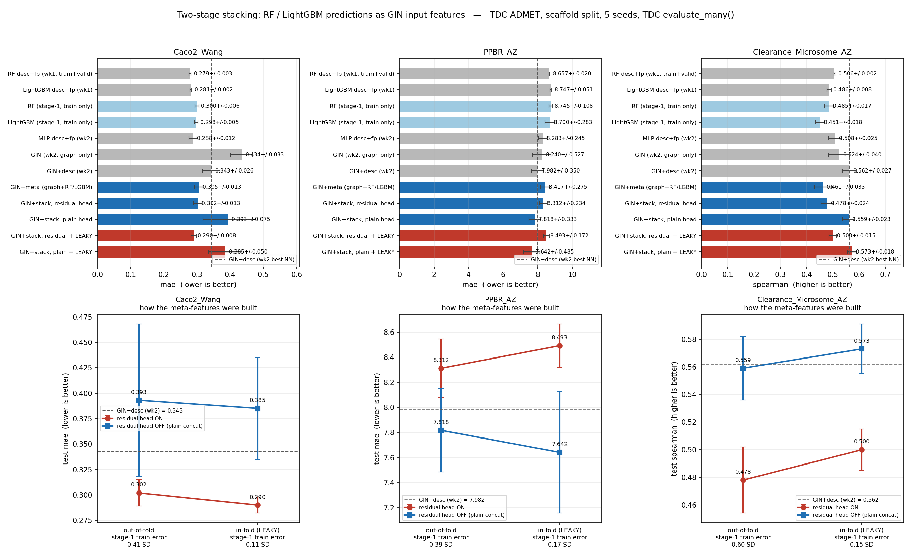

# 5주차 — 2단 스태킹: RF/LightGBM 예측값을 GIN의 입력 특징으로

**한 줄 결론: 세 과제 어디에서도 기존 최고 모델을 유의하게 넘지 못했다. 대신 왜 못 넘는지가
구조적으로 설명됐고, 설계 요소 하나(residual head)의 효과가 과제 성격에 따라 부호가 뒤집힌다는
재현 가능한 규칙을 찾았다.**

---

## 1. 무엇을 만들었나

```text
                  ┌─ desc(27) + Morgan FP(2048) ─┬─► RandomForest ──► y_rf   ─┐
SMILES ───────────┤                              └─► LightGBM     ──► y_lgbm ─┤  2차 특징
                  │                                                           │
                  └─ 원자/결합 그래프 ─► GIN 3층 ─► sum readout (128) ────────┤
                                                                              │
                              descriptor(27, train 기준 정규화) ───────────────┤
                                                                              ▼
                                                        concat(128+27+2) → head → 최종 예측
```

1단은 1주차 트리 모델을 그대로 쓴다(`rf`, `lgbm`, 특징 `desc+fp`). 2단은 2주차 GIN에
`n_meta` 블록을 더한 것이다.

| 파일 | 역할 |
| --- | --- |
| `src/stacking.py` | 1단. OOF 2차 특징 생성과 캐시 |
| `src/models.py` | 2단. `GIN(n_meta=…, residual_meta=…)` |
| `src/torch_data.py` | 그래프 배치에 meta 열 운반 |
| `src/train.py` | `build_loaders` / `build_model` / `fit_model` |
| `src/stack_predict.py` | 임의 SMILES 예측 경로 |
| `scripts/run_stack.py` | 리더보드 실행 (3 과제 × 7 조건 × 5 seed) |
| `scripts/run_stack_demo.py` | 예시 분자 추론 |
| `scripts/plot_stack.py` | `results/stack_ablation.png` |

2차 특징 열은 **원래 타깃 단위의 예측값**이고, 2단에서 타깃과 **같은 스케일러**로 정규화한다.
같은 공간에 두어야 아래 residual 연결이 성립하고, 세 과제의 단위 차이(log, %, uL/min/mg)가
타깃과 똑같이 흡수된다. descriptor와 달리 meta 열에는 BatchNorm을 걸지 않는다 — 걸면 배치마다
평균·분산이 다시 맞춰져 "이 열은 타깃 자체의 추정값"이라는 성질이 깨진다.

---

## 2. 설계 결정 세 가지

### 2.1 train 구간 2차 특징은 out-of-fold로 만든다

RF를 train 전체에 학습시킨 뒤 그 train을 다시 예측해 특징으로 쓰면 안 된다.
`min_samples_leaf=2`인 RF는 train을 거의 외우므로 그 열은 정답에 가깝다. GIN은 "그 열만 베끼면
손실 0"을 배우는데, test에서는 같은 열이 훨씬 부정확하다. **학습 때 본 특징과 예측 때 받는
특징의 분포가 다르다**는 것이 문제의 핵심이다.

그래서 train을 5조각으로 나누고, 조각 k의 특징은 조각 k를 보지 않은 모델로 예측했다(`mode="oof"`).
valid/test 특징은 두 모드 모두 train 전체에 학습한 모델로 만든다(여기에는 누출이 없다).

실제로 두 방식의 train 특징 정확도는 크게 다르다(`results/stack_meta_diagnostics.csv`,
데이터 표준편차 단위, 작을수록 정답에 가까움):

| 과제 | OOF (rf / lgbm) | in-fold (rf / lgbm) |
| --- | --- | --- |
| `Caco2_Wang` | 0.412 / 0.405 | 0.169 / **0.047** |
| `PPBR_AZ` | 0.394 / 0.386 | 0.205 / 0.145 |
| `Clearance_Microsome_AZ` | 0.591 / 0.603 | 0.262 / **0.046** |

LightGBM의 in-fold 오차는 표준편차의 0.05배다. 즉 train 라벨을 사실상 그대로 들고 있다.

### 2.2 1단은 train만 쓴다

`results/baseline.csv`의 RF/LGBM은 train+valid에 학습했다(트리 모델은 early stopping이 없어
valid를 남길 이유가 없었다). 여기서는 쓸 수 없다 — 2단 GIN이 valid로 early stopping을 하므로
1단이 valid를 보면 **모델 선택 자체가 오염된다.**

대신 같은 train-only 조건의 기반모델 단독 점수를 같이 측정한다(`rf-base`, `lgbm-base`).
스태킹이 보탬이 됐는지는 1주차 숫자가 아니라 이것과 비교해야 공정하다. 데이터가 줄어든
대가는 작지 않다 — Caco2에서 RF는 `0.279 → 0.300`으로 나빠진다(valid는 train_val의 12.5%,
세 과제 모두 동일하다). **구조를 바꾸지 않고 학습 데이터를 그만큼 늘린 것만으로 얻는 이득이,
이 실험에서 구조로 얻은 이득보다 크다.**

### 2.3 최종 출력을 "기반모델 평균 + 보정량"으로 둔다 (residual head)

head의 마지막 층을 0으로 초기화하면 학습 0 epoch 시점의 예측이 정확히 RF/LGBM 평균이다.
거기서 그래프·descriptor로 **오차를 깎아 나가는** 문제가 된다.

이 설계가 맞는지 확인하려고 끈 버전(plain concat)도 같이 돌렸다. 결과적으로 이 선택이
이번 실험에서 가장 큰 효과를 냈고, **효과의 부호가 과제마다 뒤집혔다**(4.2절).

---

## 3. 실험 설계 — 왜 2×2인가

처음에는 "OOF vs 누출" 한 축만 돌릴 생각이었다. 그런데 residual을 켠 상태에서는 그 축의
차이가 거의 없었다. 이유를 따져 보니 설계가 잘못돼 있었다.

residual head에서 "meta를 과신한다"의 귀결은 "출력 = 기반모델 평균"이다. 그런데 그 값은
test에서도 **쓸 만한 예측**이다(Caco2에서 0.298~0.300으로, 2주차 GIN+desc의 0.343보다 낫다).
즉 누출이 유도하는 행동이 우연히 괜찮은 행동이어서, **residual head가 누출의 해악을 가려
버린다.** 누출이 실제로 무엇을 망치는지는 head가 신뢰도를 *학습해야 하는* plain 쪽에서
드러나야 한다.

그래서 축을 두 개로 만들었다.

| | train 특징 OOF | train 특징 in-fold (누출) |
| --- | --- | --- |
| **residual head 켬** | `gin+stack` | `gin+stack-infold` |
| **residual head 끔** | `gin+stack-plain` | `gin+stack-plain-infold` |

여기에 `gin+meta`(descriptor를 뺀 것 — 개선이 descriptor 때문인지 기반모델 예측 때문인지
가르는 대조군)와 `rf-base` / `lgbm-base`를 더해 7조건이다.

평가는 1·2주차와 동일하게 **TDC `group.evaluate_many()`가 준 숫자만** 쓴다. valid 점수는
early stopping과 진단에만 쓴다.

---

## 4. 결과

5 seeds, mean ± std. `results/stack.csv`. 기울임은 비교용 기존 기록이다.

굵게는 이 실험의 두 주력 조건을 가리킬 뿐, 그 열의 1위라는 뜻이 아니다.

| 조건 | Caco2 MAE ↓ | PPBR MAE ↓ | Clearance ρ ↑ |
| --- | --- | --- | --- |
| *RF desc+fp (1주차, train+valid)* | *0.279 ± 0.003* | *8.657 ± 0.020* | *0.506 ± 0.002* |
| *GIN+desc (2주차)* | *0.343 ± 0.026* | *7.982 ± 0.350* | *0.562 ± 0.027* |
| RF (1단, train only) | 0.300 ± 0.006 | 8.745 ± 0.108 | 0.485 ± 0.017 |
| LightGBM (1단, train only) | 0.298 ± 0.005 | 8.700 ± 0.283 | 0.451 ± 0.018 |
| `gin+meta` (그래프 + 기반모델 예측) | 0.305 ± 0.013 | 8.417 ± 0.275 | 0.461 ± 0.033 |
| **`gin+stack` (residual, OOF)** | 0.302 ± 0.013 | 8.312 ± 0.234 | 0.478 ± 0.024 |
| **`gin+stack-plain` (plain, OOF)** | 0.393 ± 0.075 | 7.818 ± 0.333 | 0.559 ± 0.023 |
| `gin+stack-infold` (residual, 누출) | 0.290 ± 0.008 | 8.493 ± 0.172 | 0.500 ± 0.015 |
| `gin+stack-plain-infold` (plain, 누출) | 0.385 ± 0.050 | 7.642 ± 0.485 | 0.573 ± 0.018 |



### 4.1 스태킹은 기존 최고 기록을 유의하게 넘지 못했다

OOF를 쓴 정당한 조건만 놓고 보면:

* `Caco2_Wang` — `gin+stack` 0.302는 2주차 GIN+desc(0.343)보다 낫지만(약 1.4 SD),
  **같은 조건의 기반모델(0.298~0.300)과 사실상 같다.** 즉 개선의 내용은 "GNN이 트리 모델을
  재현하게 된 것"이고, 새로 얻은 정보는 없다.
* `PPBR_AZ` — `gin+stack-plain` 7.818은 프로젝트 전체 최저값이지만 GIN+desc(7.982)와의 차이가
  0.164로 각자의 std(0.333, 0.350)보다 작다. **유의하지 않다.**
* `Clearance_Microsome_AZ` — 0.559 vs 0.562로 사실상 동일하다.

세 과제 모두 **`max(기반모델, GIN+desc)`를 넘지 못했다.**

### 4.2 residual head의 효과는 어느 쪽 모델이 센지에 따라 부호가 뒤집힌다

이번 실험에서 유의한 차이를 낸 유일한 축이다.

| 과제 | 어느 쪽이 센가 | residual ON | residual OFF | 승자 |
| --- | --- | --- | --- | --- |
| Caco2 | 트리(0.298) > GIN+desc(0.343) | **0.302** | 0.393 | residual |
| PPBR | GIN+desc(7.982) > 트리(8.700) | 8.312 | **7.818** | plain |
| Clearance | GIN+desc(0.562) > 트리(0.485) | 0.478 | **0.559** | plain |

**3/3 일치한다.** residual head는 "기반모델에서 출발해 조금 고친다"는 사전지식을 넣는 장치다.
기반모델이 그 과제의 최강자면 맞는 사전지식이고(Caco2), 그래프 쪽이 더 세야 하는
과제에서는 함정이다(PPBR, Clearance).

기전은 `valid_at_init` 열이 직접 보여 준다 — 학습 **전** valid 점수(= residual에서는 기반모델
평균의 점수)와 학습 후 최선 valid를 비교한 값이다.

| 과제 | residual ON: 학습 전 → 후 | plain: 학습 전 → 후 |
| --- | --- | --- |
| Caco2 | −0.365 → −0.334 | −1.197 → −0.328 |
| PPBR | −9.900 → −9.631 | −29.489 → **−8.829** |
| Clearance | 0.498 → 0.537 | −0.013 → **0.550** |

residual을 켜면 출발점이 이미 좋아서 학습이 valid를 거의 못 움직인다. PPBR·Clearance에서는
무작위에서 출발한 plain이 **더 높은 valid에 도달한다.** best epoch 목록도 같은 말을 한다 —
`gin+stack`의 PPBR은 `[4, 46, 23, 8, 19]`, 누출 버전은 `[1, 15, 1, 9, 6]`로, epoch 1에서
멈춘 seed가 있다. 즉 2단이 사실상 아무 일도 하지 않고 기반모델을 통과시킨 것이다.

### 4.3 누출의 test 점수 영향은 검출되지 않았다 (그래도 OOF가 기본값이어야 한다)

가장 예상 밖의 결과다. 6칸 모두 OOF와 누출의 차이가 각자의 std 안에 들어간다.

| | Caco2 | PPBR | Clearance |
| --- | --- | --- | --- |
| residual: OOF → 누출 | 0.302 → 0.290 | 8.312 → 8.493 | 0.478 → 0.500 |
| plain: OOF → 누출 | 0.393 → 0.385 | 7.818 → 7.642 | 0.559 → 0.573 |

train 특징의 정확도는 2~13배나 차이 나는데(2.1절) test 점수는 안 갈린다. 두 가지가 겹친
결과로 보인다.

1. **residual 쪽** — 누출이 유도하는 행동("meta를 베껴라")이 곧 "기반모델을 출력하라"이고,
   그 출력은 test에서도 괜찮다. 누출은 붕괴가 아니라 **더 완전한 기반모델로의 퇴화**를 일으킨다.
2. **plain 쪽** — meta는 157개 입력 중 2개일 뿐이다. 첫 Linear 층의 초기 가중치가 작아
   모델이 그 열을 적극적으로 쓰려면 학습해야 하는데, 실제로는 거의 쓰지 않는다
   (그래서 `plain`의 세 숫자가 전부 GIN+desc와 붙어 있다). 쓰지 않는 열은 오염돼 있어도
   영향이 없다.

**그래도 OOF를 기본값으로 둬야 하는 이유는 바뀌지 않는다.**

* 이번에 가려졌다는 것을 **미리 알 방법이 없다.** OOF 버전을 같이 만들어 비교했기 때문에
  알게 된 것이다.
* 누출된 설정에서는 **train 쪽 진단이 쓸모없어진다.** LightGBM의 in-fold 오차 0.046 SD를
  보고 "특징이 아주 좋다"고 읽으면 완전히 틀린 판단을 하게 된다.
* 누출 조건이 명목상 더 나은 칸(Clearance 0.573)을 결과로 보고하는 것은, 차이가 노이즈
  안인데다 절차적으로 방어할 수 없다.

### 4.4 왜 개선이 없었나 — 두 단계가 같은 정보를 본다

이것이 이번 실험의 구조적 결론이다.

1단은 `descriptor + Morgan fingerprint`를 본다. 2단 GIN은 `원자/결합 그래프 + descriptor`를
본다. Morgan fingerprint는 반지름 2짜리 국소 부분구조의 해시이고, 그래프 message passing 3층은
3결합 이웃까지의 국소 구조를 **학습해서** 요약한다. 즉 1단이 2단에게 전달하는 2개 열에는
2단이 자기 입력에서 이미 끌어낼 수 있는 정보밖에 들어 있지 않다.

스태킹이 이득을 내는 조건은 기반모델이 **2단이 볼 수 없는 정보**를 보는 경우다. 여기서는
그 조건이 성립하지 않는다.

---

## 4.5 예시 분자 추론 — 2단은 실제로 무엇을 고치는가

평균 지표(MAE, Spearman)는 test set 전체의 평균이라 "2단이 1단 예측을 실제로 고쳤는가,
아니면 그냥 베꼈는가"를 말해 주지 않는다. 그래서 알려진 약물 8개를 넣고 분자마다 네 숫자를
나란히 봤다(`scripts/run_stack_demo.py`, plain head, 3 seeds, `results/stack_demo.csv`).

누출 점검 방식은 3주차 `run_sanity.py`와 같다 — 대상 분자를 입체화학 무시 골격으로 찾아
**train/valid에서 전부 빼고 다시 학습**하고, 정답은 데이터셋 자신의 라벨을 쓴다.

정답이 있는 14건 중 **13건 합당, 1건 경계**. 오차 중앙값은 데이터셋 표준편차 기준으로
**1단 평균 0.55 SD → 2단 0.40 SD**로 줄었고, 2단이 정답 쪽으로 움직인 분자가 **11/14**다.

| 과제 | 1단 평균 → 2단 (오차 중앙값, SD 단위) |
| --- | --- |
| `Caco2_Wang` | 0.42 → 0.37 |
| `PPBR_AZ` | 0.59 → 0.44 |
| `Clearance_Microsome_AZ` | 0.87 → 0.40 |

### 2단이 크게 고친 경우 — 데이터셋 중심에서 먼 분자

| 분자 / 과제 | 정답 | RF | LGBM | 1단 평균 | 2단 최종 | 오차 (SD) |
| --- | --- | --- | --- | --- | --- | --- |
| Caffeine / PPBR (%) | 17.6 | 70.7 | 59.1 | 64.9 | **33.0** | 2.52 → **0.82** |
| Theophylline / PPBR (%) | 33.9 | 71.2 | 59.2 | 65.2 | **48.0** | 1.67 → **0.75** |
| Verapamil / Clearance | 127.7 | 54.9 | 75.3 | 65.1 | **105.9** | 1.42 → **0.49** |
| Diazepam / PPBR (%) | 93.1 | 85.0 | 75.5 | 80.3 | **93.9** | 0.68 → **0.04** |

카페인과 테오필린은 PPBR 데이터셋(평균 86.4%)에서 극단적으로 낮은 쪽에 있는 xanthine이다.
트리 모델은 둘 다 60~70%로, 사실상 **데이터셋 평균 쪽으로 회귀**해 버린다. 2단 GIN이 이를
33%/48%로 끌어내렸다. 베라파밀은 반대 방향 — 고청소율 약물인데 트리 모델이 65로 낮게
보던 것을 106으로 올렸고, **이 분자는 test split에 있어 애초에 학습에 쓰이지 않았다.**

즉 2단이 보태는 지점은 **1단이 평균으로 회귀하는 구간**이다. 부분구조 비트의 최근접
이웃 평균으로는 설명되지 않는 분자에서 그래프 표현이 작동한다.

### 2단이 망친 경우 — 그리고 PBPK 입력을 바꾸지 않는 이유

| 분자 / 과제 | 정답 | 1단 평균 | 2단 최종 | 오차 (SD) |
| --- | --- | --- | --- | --- |
| **Propranolol / PPBR (%)** | 82.5 | 73.3 | **62.5** | 0.49 → **1.07** |

하필 3주차 PBPK의 대상 분자다. 2단이 단백결합률을 10%p 더 낮춰 유일한 "경계" 판정이 나왔다.
PPBR은 `fu = 1 − PPB/100`으로 들어가므로, 82.5% 대신 62.5%를 쓰면 `fu`가 0.175에서 0.375로
**2배 이상** 커지고 `E_h`와 clearance 추정이 통째로 틀어진다.

따라서 `pbpk/predict_admet.py`의 입력 모델은 **바꾸지 않았다.** 3주차 PBPK 숫자는 RandomForest
예측에 기반한 것으로 그대로 둔다. 리더보드 평균이 비슷하다고 해서 특정 분자에서도 더 나은
것은 아니며, PBPK는 분자 하나에 전적으로 의존한다.

---

## 5. 재현

```bash
python scripts/run_stack.py          # 3 과제 x 7 조건 x 5 seed  -> results/stack.csv
python scripts/plot_stack.py         # -> results/stack_ablation.png
python scripts/run_stack_demo.py     # 예시 분자 추론 -> results/stack_demo.csv

# 임의 분자를 넣어 보려면
python scripts/run_stack_demo.py --tasks PPBR_AZ --seeds 1 \
    --smiles "Ibuprofen=CC(C)Cc1ccc(cc1)C(C)C(=O)O"
```

1단 특징은 `results/meta_cache/`에 캐시된다. 캐시 키에 입력 SMILES와 타깃의 해시가 들어가므로,
데이터가 바뀌면 캐시가 빗나가 다시 계산한다(옛 특징을 조용히 재사용하지 않는다).
처음 실행은 OOF 생성 때문에 약 50분, 캐시가 있으면 약 15분이다.

**기존 결과가 바뀌지 않았음을 확인했다.** `n_meta=0`일 때 새 모듈을 만들지 않아 파라미터
초기화의 난수 소비 순서가 유지된다. 리팩터 후 재실행 결과:

| | 재실행 | `results/models.csv` |
| --- | --- | --- |
| `gin` Caco2 | 0.4340 ± 0.0330, epochs `19\|40\|94\|26\|60` | 0.434 ± 0.033, `19\|40\|94\|26\|60` |
| `gin+desc` Caco2 | 0.3430 ± 0.0260, epochs `39\|76\|32\|29\|109` | 0.343 ± 0.026, `39\|76\|32\|29\|109` |

best epoch 목록까지 같다.

---

## 6. 한계와 다음 단계

* **2단의 hyperparameter를 2주차 값 그대로 썼다.** residual 조건은 출발점이 좋아
  learning rate가 상대적으로 크고, 그래서 즉시 과적합했을 가능성이 있다. valid만 보고
  residual 전용 lr을 따로 고르는 것은 절차상 정당하지만 이번에는 하지 않았다.
  하면 `gin+stack`이 기반모델 위로 조금 올라갈 수 있다.
* **1단이 2단과 같은 정보를 본다**(4.4절). 이것을 푸는 방향이 다음 단계다.
  * 다른 assay에 학습한 모델을 1단에 넣기(예: Clearance 예측에 `Lipophilicity`,
    `CYP` 과제 모델의 출력을 넣기 — TDC ADMET group 안에 이미 있다)
  * conformer 기반 3D descriptor처럼 2D 그래프에서 유도되지 않는 특징
* **residual 설계를 과제별로 고르는 규칙**(4.2절)은 3개 과제에서만 확인했다. 과제 수를
  늘려야 규칙이라고 부를 수 있다.
* 2단의 seed 간 std가 여전히 크다(0.013~0.485 vs 트리 0.005~0.283).
